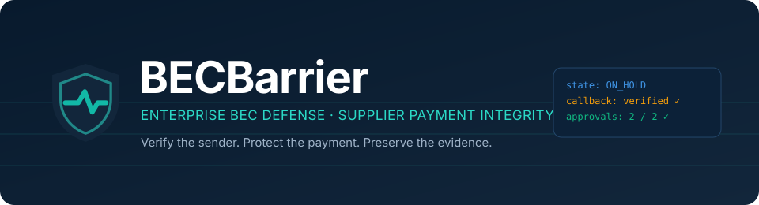
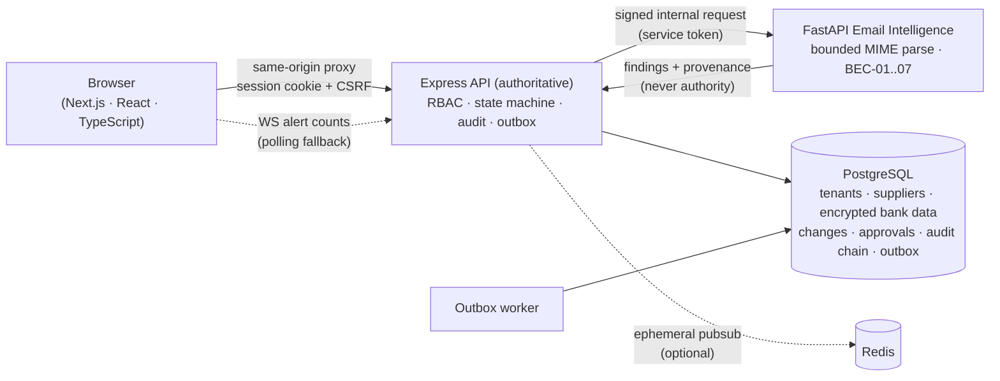
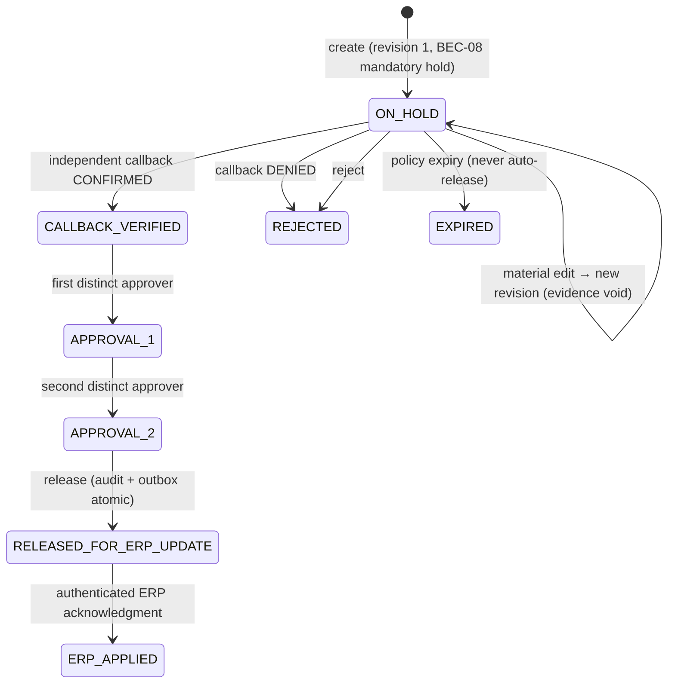

<div align="center">



# BECBarrier

**Enterprise business email compromise defense and supplier-payment verification with explainable email indicators, independent callbacks, dual approval and auditable financial controls.**

[](https://github.com/etalyahsimpson/becbarrier/actions/workflows/ci.yml)


*Verify the sender. Protect the payment. Preserve the evidence.*

</div>

---

## The problem BECBarrier solves

A convincing email can appear to come from a trusted supplier and request an urgent banking change. Pure email analysis can never prove a payment instruction is legitimate — so BECBarrier treats **every mail signal as advisory** and makes supplier bank changes pass a governed, server-enforced workflow:

> **Any new bank-account instruction enters `ON_HOLD` → requires a callback to a previously approved directory contact → requires two distinct eligible approvals → only then produces a controlled ERP update instruction.** No funds move inside BECBarrier.

No email analysis result — not even a "perfect" SPF/DKIM/DMARC pass — can bypass this sequence. That is the core design invariant, and it is enforced by the authoritative TypeScript API against PostgreSQL, never by the browser.

## What BECBarrier prevents in its own workflow

| Threat | Control |
|---|---|
| Supplier/executive impersonation email | BEC-01…07 deterministic indicators with reason codes and redacted evidence |
| Forged `Authentication-Results: spf=pass` claims | Raw uploads are `UNTRUSTED_CLAIM` — SPF stays `UNKNOWN`, never verified (T02) |
| Phone number supplied only in the fraud email | Callback must use a directory contact established **before** the request (invariant 3, T07) |
| Requester approves their own change | Four distinct identities required: initiator, verifier, approver 1, approver 2 (T06) |
| Stale approvals after an edit | Material edit creates a new immutable revision and voids prior evidence (T05) |
| Concurrent duplicate approvals/releases | Row locks + idempotency keys + composite unique constraints (T08, T17) |
| Tampered audit history | HMAC-SHA-256 chained, append-only for the app role, verifier CLI (T10, T11) |
| Cross-tenant data access | Tenant-scoped queries everywhere; cross-tenant UUIDs return neutral 404s (T09, T15) |

## The three business workflows (runnable, not scripted)

1. **Blocked suspicious request** — `fixtures/emails/S02` (lookalike domain + bank-change language) → reason-coded CRITICAL alert → bank change `ON_HOLD` → callback `DENIED` → `REJECTED` with full audit trail. Executed end-to-end in [tests/e2e](tests/e2e) and the 26 scenario fixtures.
2. **Legitimate-looking but still governed** — an authenticated-looking supplier email (S04) still forces `ON_HOLD`; verified callback + two distinct approvals produce `RELEASED_FOR_ERP_UPDATE` — an export instruction only.
3. **Privilege & concurrency failures** — self-approval, duplicate approver, stale revision, racing releases and cross-tenant access all fail closed without corrupting state (`tests/integration`).

## Architecture





## Stack (every entry is load-bearing)

| Layer | Technology | Responsibility |
|---|---|---|
| Web | Next.js 16 (App Router), React 19, Tailwind CSS 4, TanStack Query, React Hook Form, Zod | Role-aware finance/security workbench |
| Authoritative API | Node.js, Express 5, TypeScript | Sessions, RBAC, tenant scoping, state machine, transactional writes |
| Email intelligence | Python 3.12, FastAPI, Pydantic 2 | Safe `.eml` parsing, provenance, BEC-01..07 (non-authoritative) |
| Data engineering | Pandas, NumPy | Deterministic fixture evaluation report ([docs/EMAIL_EVALUATION.md](docs/EMAIL_EVALUATION.md)) |
| Database | PostgreSQL 16, parameterized SQL, versioned reversible migrations | Authoritative source of truth |
| Ephemeral | Redis (optional) | Rate-limit buckets; never a financial authority |
| Realtime | WebSockets (`ws`) | Tenant-scoped alert counts with polling fallback |
| Security | HMAC-signed sessions, CSRF double-submit, AES-256-GCM, HMAC-SHA-256 | Trusted server-side validation and encrypted data |
| Async | TypeScript worker + transactional outbox | Redacted notifications; never releases payments |
| Tests | Jest, pytest, Playwright | Unit · integration · security · browser E2E |
| Infra | Docker Compose, GitHub Actions | One-command local stack, gated CI |

## Test results

All gates run in [GitHub Actions CI](https://github.com/etalyahsimpson/becbarrier/actions/workflows/ci.yml) on every push. Local reproduction:

```bash
npm run test:unit && npm run test:python && npm run test:integration && npm run test:security
```

- **Unit (Jest):** state machine, separation-of-duties policies, scoring, AES-GCM context binding, session signing, audit-chain verification
- **Python (pytest):** bounded parser, provenance rules, all BEC-01..07 rule contracts, internal FastAPI boundary (incl. oversize 413, T02 auth-claim handling)
- **Integration (Jest + PostgreSQL):** all **32 email fixtures** through the live API, **26 bank-change scenarios** (≥12 negative / ≥12 valid-edge) executed against the real state machine, and the **T01–T18 acceptance matrix**
- **Security (Jest):** T13/T15 session, CSRF, membership and privilege-downgrade denials; role matrix; rate limiting; security headers
- **Audit verification:** `npm run test:audit-verify` recomputes the full HMAC chain per tenant

Fixture counts: **32** `.eml` (8 normal / 12 suspicious / 6 ambiguous / 6 malformed) with engine-computed expectations, **26** workflow scenarios, **40+** concurrency/replay attempts in the concurrency suite. These are synthetic-fixture agreements — **not** real-world detection-accuracy claims.

## Quick start (Docker)

```bash
bash scripts/setup-demo.sh        # generates local-only secrets into .env (never committed)
docker compose -f infra/compose.yaml up --build -d
# in a second shell, with the compose postgres as MIGRATION_DATABASE_URL:
npm run db:migrate && npm run db:setup-roles && npm run db:seed:synthetic
open http://localhost:3000
```

Local (non-Docker) development:

```bash
npm ci && bash scripts/setup-demo.sh   # point DATABASE_URL at your PostgreSQL
npm run db:migrate && npm run db:setup-roles && npm run db:seed:synthetic
npm run dev:api &  (cd services/email-intelligence && uvicorn app.main:app --port 8001) &  npm run dev:web
```

Sign in on `/login` with any seeded demo identity (e.g. **Ellis Marsh — Security Analyst** or **Casey Nakamura — Finance Approver**, Atlas Precision Manufacturing). The role switcher is provided **only** by the development identity adapter — production requires a real OIDC provider and fails closed without one.

## Documentation

| Document | Contents |
|---|---|
| [Architecture](docs/ARCHITECTURE.md) | Topology, TypeScript/Python boundary, failure modes |
| [Security model](docs/SECURITY_MODEL.md) | Hard invariants, roles, tenant isolation, CSRF, OIDC limits |
| [Threat model](docs/THREAT_MODEL.md) | Conventional BEC surface, controls, residual risks |
| [Financial workflow](docs/FINANCIAL_WORKFLOW.md) | State machine, callback protocol, idempotency, denial cases |
| [Email evaluation](docs/EMAIL_EVALUATION.md) | BEC-01..07 rules, provenance, fixture results, uncertainty |
| [Data protection](docs/DATA_PROTECTION.md) | AES-GCM, keyed fingerprints, masked display, key separation |
| [API reference](docs/API_REFERENCE.md) | REST routes, errors, internal FastAPI boundary |
| [Testing & results](docs/TESTING_AND_RESULTS.md) | Commands, T01–T18 coverage, fixture totals |
| [Engineering decisions](docs/ENGINEERING_DECISIONS.md) | Why Python was added, why Express owns state, why no AI model |
| [Case study](docs/PROJECT_CASE_STUDY.md) | Problem → solution → evidence → limits |
| [Skills validation](docs/SKILLS_VALIDATION.md) | Each technology → source → behavior → executed test |
| [Operations](docs/OPERATIONS.md) | Compose, migrations, backups, runbook |
| [Release verification](docs/RELEASE_VERIFICATION.md) | Remote commit, CI conclusion, checks |
| [Limitations](docs/LIMITATIONS.md) | What this release is not |

Interactive API docs: `GET /api/v1/openapi.json` · Postman collection: [postman/BECBarrier.postman_collection.json](postman/BECBarrier.postman_collection.json)

## Security model in brief

- **Ten security invariants** enforced server-side and covered by negative tests (see [docs/SECURITY_MODEL.md](docs/SECURITY_MODEL.md))
- Bank fields encrypted with **AES-256-GCM** (unique nonce, tenant/supplier/revision bound as AAD); equality via **HMAC-SHA-256 keyed fingerprints** — never unkeyed hashes of low-entropy account numbers
- Audit events are append-only for the application role and chained with per-tenant HMAC sequences; a failed audit write **rolls back the financial mutation**
- Least-privilege DB roles: `bb_api` (no UPDATE/DELETE on audit/revision history), `bb_worker` (outbox only), `bb_audit_ro` (read-only)
- Local demo identity adapter is development/test-only; production boot **fails closed** without OIDC configuration

## Known limitations (honest scope)

- Not an SMTP gateway, malware scanner, bank verification authority or funds-movement system; `RELEASED_FOR_ERP_UPDATE` produces an instruction for an external, separately authorized ERP update
- No live mailbox connector, real IdP or ERP integration in this release — the ERP ack endpoint is a clearly-marked local contract demonstration
- Email indicators are conservative heuristics with explicit `UNKNOWN` outcomes; the demo score is a triage priority, not a fraud probability
- Synthetic fixtures demonstrate the stated contracts only; no real-world detection-effectiveness claim is made

## Future roadmap

Consented mailbox connectors (Microsoft 365 / Google Workspace), trusted delivery-gateway authentication evidence, ERP adapter with authenticated reconciliation, enterprise notification fanout, calibrated analyst-prioritization analytics.

---

<div align="center">

**BECBarrier · Independent Engineering Portfolio Project · © 2026 Etalyah Simpson · All rights reserved.**

No general redistribution license is granted. Source is public for inspection — see [docs/LIMITATIONS.md](docs/LIMITATIONS.md).

[Official Portfolio](https://etalyahsimpson.github.io/)

</div>
